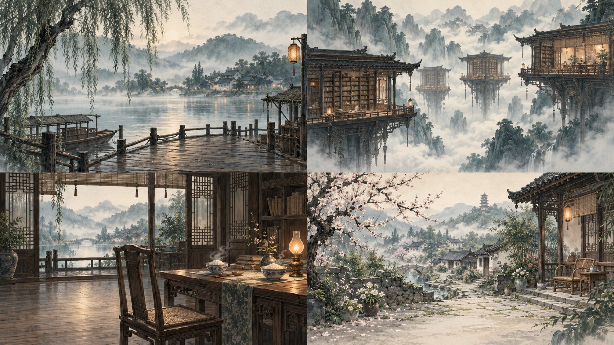

# 归宁 · Guining

**纸上留人，灯下留席。**

一款水墨叙事游戏，以三段可自由选择顺序的回忆，讲述一次归途。包含视觉小说、第一人称提灯迷宫、三维悬浮书楼、随机理稿、纸兵与纸龙反弹、四季追信、拼玉及完整终章。

**非商业源码公开，禁止未经授权的商业使用。** 允许在许可范围内试玩、学习、修改和非商业分享。本项目带有非商业限制，因此不宣称属于 OSI 定义的开源软件。



## 下载试玩

请到 [Releases 试玩下载页](https://github.com/laujoe/guining/releases/tag/v0.1.3) 下载以下文件：

| 文件 | 用途 |
| --- | --- |
| `Guining-Windows-0.1.3-Setup.exe` | Windows 10/11 x64 安装版，当前用户安装，可卸载 |
| `Guining-Windows-0.1.3.zip` | Windows 便携版，完整解压后运行 `Guining.exe` |
| `Guining-Android-0.1.3-test.apk` | Android ARM64 / x86_64 横屏测试版，使用调试签名 |
| `SHA256SUMS.txt` | 文件校验值 |

游戏离线运行，不需要安装 Godot、不需要账户。Windows 需要支持 OpenGL 3.3 的显卡；Android 需要 Android 7.0（API 24）以上、支持 OpenGL ES 3.0 的 64 位设备。APK 是侧载试玩包，尚未通过 Android 真机完整流程与性能验收，不是商店发行版。不同签名的后续 APK 可能不能覆盖安装，卸载前务必备份存档。

Windows 程序和安装包尚未做商业代码签名。Windows 安装版与便携版共用 `%APPDATA%\Guining` 存档；卸载器保留玩家存档。Android 使用应用自己的沙盒目录。

## 操作与辅助

| 场景 | 键鼠 | 触屏 |
| --- | --- | --- |
| 对话 | 点击继续 / E / 空格 | 点击“继续”，首次显示全文，再点推进 |
| 借光 | WASD / 方向键；拖动转头；M 地图 | 底部前进、后退、左右转向，可双指组合；顶部地图 |
| 转镜 | Q/E 转视角，点击“入影”，拖动移灯 | 屏幕按钮与滑杆 |
| 理稿 | 点击最上层牌，同类三张消除 | 点击牌；撤销、暂存、取回均有按钮 |
| 批阵 | WASD / 方向键；J 挥笔；空格闪避 | 左侧方向键，右侧挥笔和闪避，支持双指 |
| 追信 | 空格跳，S 低身，按住 E 顶风 | 跳、低身、按住顶风，可组合操作 |
| 拼玉 | 拖动；Tab 选片、方向键、E 放置 | 拖动碎片；30 秒后可用辅助吸附 |
| 暂停 | Esc / 窗口失焦 | 暂停按钮 / Android 返回键 |

提供文字大小、音量、减少动态、宽松笔锋和单击代替长按。主菜单“记忆图谱”可查看历史存档；暂停时“记下此刻”另存一卷。读取旧卷前先保存当前进度；设置不随读档回滚。新故事会确认并归档旧存档；坏存档和较新 schema 不会被静默覆盖。

## 从源码运行

1. 安装 **Godot 4.7.2 Standard**（无需 .NET），导入本目录的 `project.godot`。
2. 入口 `scenes/main.tscn`，按 F5 运行。源码快照不需要开发插件、SDK、API Key 或其他游戏工程。
3. 导出时安装相同版本的 Godot 导出模板。PowerShell 工具要求 **PowerShell 7**。

```powershell
$env:GODOT_PATH = '你的 Godot 可执行文件完整路径'
pwsh -File tools/run-tests.ps1
pwsh -File tools/package-windows.ps1 -PackageName Guining-Windows-0.1.3
```

Android、Windows 安装器与干净源码打包见 [构建说明](docs/BUILDING.md)。GitHub 上传步骤见 [发布说明](docs/RELEASING.md)。

本次构建与验收状态见 [0.1.3 试玩记录](docs/RELEASE-0.1.3.md)。

## 工程结构

- `scripts/game_core.gd`：规则、进度条件、随机理稿与 schema 1 存档验证。
- `scripts/main.gd`：流程、界面与输入；各演出和三维场景独立脚本。
- `scenes/`：游戏入口与记忆图谱界面。
- `data/`：对白、叙事、小游戏配置与检查点。
- `assets/`：游戏美术、字体、音乐和离线许可。
- `tests/`：规则、交互、存档、三维谜题和多指触屏回归。
- `tools/`：测试、导出、Windows 安装器、Android 与源码打包。

## 许可与来源

| 范围 | 许可 |
| --- | --- |
| 项目自有代码与工程配置 | [PolyForm Noncommercial 1.0.0](LICENSE) |
| 自有剧情、数据、美术、音效和文档 | [CC BY-NC-SA 4.0](licenses/CC-BY-NC-SA-4.0.txt) |
| 霞鹜文楷 | SIL Open Font License 1.1 |
| Kevin MacLeod 配乐 | CC BY 4.0 |
| Godot 引擎及其组件 | 原有 MIT 等许可 |

请保留署名、许可及修改说明。不能将本游戏或自有素材用于销售、广告变现、内购或其他未经授权的商业用途；具体范围以许可全文为准。第三方作品原许可不受本项目非商业限制改变。

美术包含 AI 辅助生成与作者提供的原图。详见 [NOTICE](NOTICE.txt)、[第三方说明](THIRD-PARTY-NOTICES.md) 和 [素材记录](docs/ASSETS.md)。

## 当前边界与反馈

当前版本是完整流程试玩，未完成五人盲测、目标手机与集显性能验收、商店提交。书楼采用固定观景站位的透视谜题；没有配音。Android 已加入触屏入口，但多种屏幕比例、系统手势与长时间游玩仍需真机测试。

欢迎按 [贡献指南](CONTRIBUTING.md) 提交问题与改进。请附上游戏版本、设备、复现步骤和预期结果。
